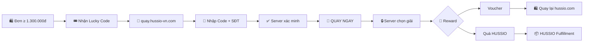
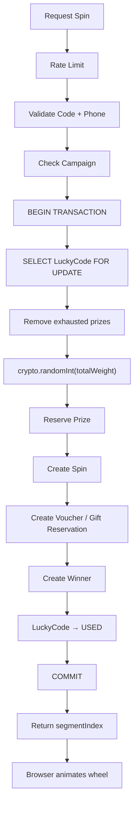
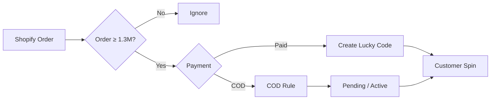
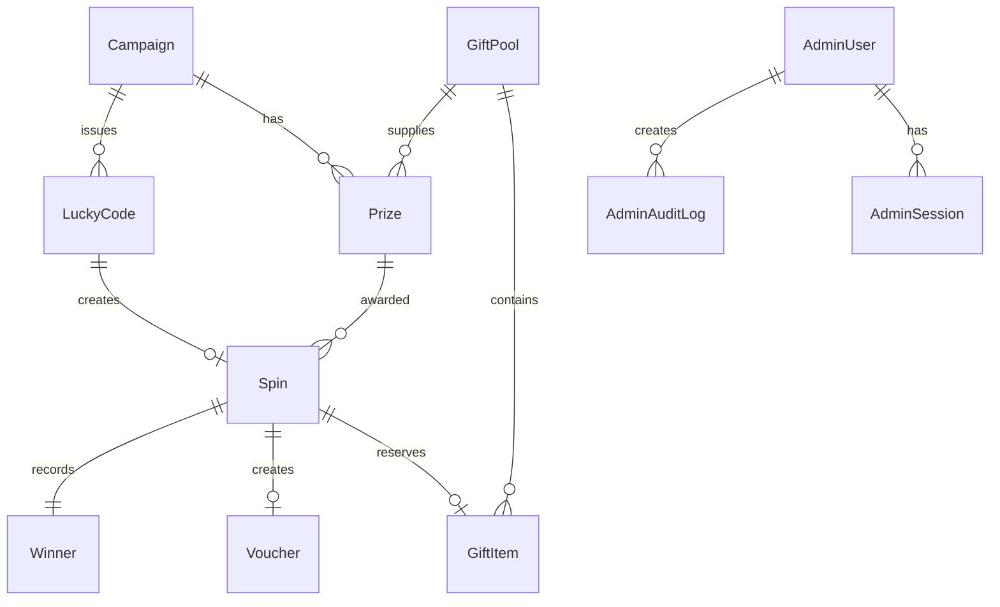

<div align="center">

# 🎡 HUSSIO LUCKY SPIN

### Black Friday Reward Platform 2026

**Mua từ 1.300.000đ → Nhận 01 mã quay → 100% có quà.**

Một nền tảng Lucky Spin độc lập dành cho HUSSIO, kết nối Shopify và hỗ trợ đơn hàng từ **Website, Facebook và Cửa hàng**.

[](https://nextjs.org/)
[](https://react.dev/)
[](https://www.typescriptlang.org/)
[](https://www.postgresql.org/)
[](https://www.prisma.io/)
[](https://shopify.dev/)
[](#-testing)

**HUSSIO:** [hussio.com](https://hussio.com)  
**Lucky Spin:** [quay.hussio-vn.com](https://quay.hussio-vn.com)

</div>

---

## ✨ Tổng quan

**HUSSIO Lucky Spin** là hệ thống vòng quay nhận quà được xây dựng cho chiến dịch Black Friday 2026 của HUSSIO.

Khách hàng có đơn từ **1.300.000đ** sẽ nhận một Lucky Code. Mã này có thể được phát từ:

- Shopify Website
- Facebook
- Cửa hàng HUSSIO

Khách truy cập **quay.hussio-vn.com**, nhập mã cùng số điện thoại mua hàng và nhận **01 lượt quay**.

Điểm quan trọng nhất:

> 🎯 **Kết quả giải thưởng không được quyết định trên trình duyệt.**

Prize selection được thực hiện hoàn toàn ở backend bằng cryptographically secure random, database transaction và row locking.

Điều này giúp hệ thống chống double-spin, refresh, nhiều tab hoặc nhiều request đồng thời.

---

# 🚀 Customer Flow



### Business Rule

```text
Đơn < 1.300.000đ
→ Không đủ điều kiện

Đơn ≥ 1.300.000đ
→ 01 Lucky Code
→ 01 lượt quay

2.600.000đ
→ MVP vẫn 01 lượt
```

Hệ thống đã có `multiSpinEnabled` để hỗ trợ nhiều lượt theo giá trị đơn trong tương lai.

---

# 🎁 Prize Engine

Campaign mặc định sử dụng 9 loại giải:

| Reward | Type |
|---|---|
| Voucher 30K | Voucher |
| Voucher 50K | Voucher |
| Voucher 100K | Voucher |
| Freeship | Voucher / Shipping |
| Áo Polo HUSSIO | Physical Gift |
| Áo thun HUSSIO | Physical Gift |
| Sơ mi HUSSIO | Physical Gift |
| Áo khoác HUSSIO | Physical Gift |
| Quần HUSSIO | Physical Gift |

Tất cả:

```text
Weight
Stock
Quota
Active status
Display order
```

đều được quản lý từ Admin Dashboard.

Không cần sửa source code khi muốn thay tỷ lệ giải.

---

# 🎯 Server-side Weighted Random

Spin API:

```text
POST /api/lucky/spin
```

Quy trình:



### Không dùng

```js
Math.random()
```

để quyết định giải thưởng.

### Sử dụng

```js
crypto.randomInt()
```

cho toàn bộ real prize selection.

Frontend chỉ nhận:

```json
{
  "segmentIndex": 4
}
```

và thực hiện animation đến đúng vị trí server đã quyết định.

---

# 🛡️ Anti Double-Spin

Hệ thống được thiết kế để chống:

```text
Double click
Refresh
Hai browser tabs
Replay request
Network retry
Nhiều request đồng thời
```

Database enforce:

```text
LuckyCode.code UNIQUE
Spin.luckyCodeId UNIQUE
Voucher.code UNIQUE
Voucher.spinId UNIQUE
Winner.spinId UNIQUE
WebhookEvent.webhookId UNIQUE
```

Nếu khách gửi lại request sau khi mã đã quay:

> Hệ thống trả về **chính kết quả cũ**.

Không quay lại.

Không trừ kho lần hai.

---

# 🛍️ Shopify Integration

HUSSIO Lucky Spin kết nối Shopify thông qua:

**Shopify Admin GraphQL API**

API version:

```text
2026-10
```

Hệ thống hỗ trợ:

```text
Shopify Orders
Order Paid webhook
Order Cancelled webhook
COD workflows
Automatic Lucky Code generation
Shopify Discount Code generation
Order tags
Order metafields
Webhook HMAC validation
Webhook idempotency
```

### Shopify Order Flow



COD có thể cấu hình:

```text
CONFIRMED_ORDER
PAID
MANUAL_APPROVAL
```

---

# 🏪 Omnichannel

Lucky Spin không phụ thuộc hoàn toàn vào Shopify.

Admin có thể phát mã cho đơn:

### Facebook

```text
Customer Name
Phone
Facebook Order Reference
Order Value
Channel = FACEBOOK
```

### Cửa hàng

```text
Customer Name
Phone
Bill ID
Order Value
Channel = STORE
```

### Website

Shopify webhook có thể tự động tạo code.

Ngoài ra hệ thống hỗ trợ:

```text
Bulk Import CSV
```

cho lượng đơn lớn.

---

# 🧑‍💼 Admin Dashboard

Admin panel:

```text
/admin
```

Bao gồm:

| Module | Chức năng |
|---|---|
| Dashboard | KPI tổng quan |
| Codes | Quản lý Lucky Code |
| Generate Code | Tạo mã Facebook / Store |
| Import | Import CSV |
| Campaign | Cấu hình chương trình |
| Prizes | Quản lý tỷ lệ giải |
| Gift Inventory | Kho quà |
| Winners | Người trúng |
| Vouchers | Voucher |
| Analytics | Tracking campaign |
| Settings | Cấu hình hệ thống |

### Roles

```text
ADMIN
STAFF
```

Các thao tác quan trọng đều được ghi:

```text
AdminAuditLog
```

---

# 🎁 Gift Inventory

Gift pool Black Friday 2026 ban đầu:

| Nhóm | Số lượng |
|---|---:|
| Polo | 83 |
| Áo thun | 40 |
| Sơ mi | 30 |
| Áo khoác | 12 |
| Quần dài | 7 |
| **Tổng** | **172** |

Tổng giá vốn ban đầu:

```text
≈ 16.282.700 VND
```

Gift inventory hỗ trợ:

```text
Category
Product
Size
Quantity
Cost
Active status
Fulfillment status
```

Khi quà hết kho:

> Prize đó tự động bị loại khỏi random pool.

---

# 🧾 Voucher

Voucher Lucky Spin:

```text
HUSSIO-WHEEL-XXXXXX
```

Mỗi voucher:

```text
Unique
Usage limit = 1
Expiration
Minimum spend
Shopify Discount Code
Linked to exactly one Spin
```

Voucher được thiết kế để sử dụng cho **đơn hàng tiếp theo**, giúp Lucky Spin trở thành một phần của retention funnel:

```text
Purchase
   ↓
Lucky Spin
   ↓
Reward
   ↓
Voucher
   ↓
Repeat Purchase
```

---

# 👤 Winner Feed

Website có khu vực:

## NGƯỜI MAY MẮN GẦN ĐÂY

Public API chỉ trả:

```text
Masked Name
Province / City
Prize
Time
```

Ví dụ:

```text
Hứa H***
TP. Hồ Chí Minh
Voucher 100K
3 phút trước
```

Không public:

```text
Phone
Email
Order ID
Lucky Code
Address
```

Và đặc biệt:

> Không tạo fake winner.

---

# 🔐 Security

Security là một phần của architecture, không phải feature bổ sung sau cùng.

### Customer

- Rate limiting theo IP
- Origin validation
- Code normalization
- Phone HMAC-SHA256
- Constant-time hash comparison
- Sai 5 lần → lock code 30 phút
- Secure random
- Database transaction
- Row locking

### Admin

- `scrypt` password hashing
- 256-bit random session token
- HttpOnly cookie
- SameSite=Lax
- Secure cookie production
- ADMIN / STAFF role
- Login rate limiting
- Audit log

### Shopify

- Raw-body webhook HMAC verification
- Constant-time signature verification
- Shop domain verification
- Webhook idempotency

### Security Headers

```text
X-Frame-Options: DENY
X-Content-Type-Options: nosniff
Strict-Transport-Security
Referrer-Policy
Permissions-Policy
```

`/admin` được:

```text
noindex
```

---

# 🏗️ Tech Stack

| Layer | Technology |
|---|---|
| Framework | Next.js 16.4 — App Router |
| Frontend | React 19.3 |
| Language | TypeScript Strict |
| UI | Tailwind CSS 4 |
| Typography | Be Vietnam Pro + Playfair Display |
| Database | PostgreSQL |
| ORM | Prisma ORM 7 |
| Shopify | Admin GraphQL API |
| Shopify Client | `@shopify/admin-api-client` |
| Unit / Integration | Vitest 5 |
| E2E | Playwright |
| Deployment | Vercel |
| Production DB | Neon / Vercel Postgres / Supabase |

---

# 📂 Project Structure

```text
hussio-lucky-spin/
│
├── prisma/
│   ├── schema.prisma
│   ├── migrations/
│   ├── seed-data.ts
│   └── seed.ts
│
├── src/
│   ├── app/
│   │   ├── page.tsx
│   │   ├── api/
│   │   │   ├── lucky/
│   │   │   │   ├── validate/
│   │   │   │   ├── spin/
│   │   │   │   └── confirm/
│   │   │   ├── winners/
│   │   │   ├── events/
│   │   │   ├── webhooks/shopify/
│   │   │   └── health/
│   │   │
│   │   └── admin/
│   │
│   ├── components/
│   │   ├── home/
│   │   ├── spin/
│   │   ├── admin/
│   │   └── brand/
│   │
│   ├── lib/
│   ├── server/
│   └── proxy.ts
│
├── tests/
│   ├── unit/
│   ├── integration/
│   └── helpers/
│
├── e2e/
│
├── scripts/
│
├── shopify-theme/
│   └── snippets/
│
├── docs/
│   ├── DEPLOYMENT.md
│   ├── SHOPIFY_SETUP.md
│   ├── ADMIN_GUIDE.md
│   └── marketing/
│       └── CONTENT.md
│
└── README.md
```

---

# ⚡ Quick Start

## Requirements

```text
Node.js >= 22.12
npm
PostgreSQL
```

Project có embedded PostgreSQL cho local development nên **không bắt buộc Docker**.

### 1. Clone

```bash
git clone https://github.com/HuaThinhHung/Hussio-Lucky-Spin.git
cd Hussio-Lucky-Spin
```

### 2. Install

```bash
npm install
```

### 3. Environment

macOS / Linux:

```bash
cp .env.example .env
```

Windows:

```powershell
copy .env.example .env
```

Điền các biến cần thiết trong `.env`.

### 4. Start local PostgreSQL

```bash
npm run db:local
```

### 5. Migration

Mở terminal khác:

```bash
npm run db:migrate
```

### 6. Seed

```bash
npm run db:seed
```

Seed tạo:

```text
Black Friday 2026 Campaign
9 Prize Types
172 Physical Gifts
Initial Admin User
```

### 7. Development Server

```bash
npm run dev
```

Customer:

```text
http://localhost:3000
```

Admin:

```text
http://localhost:3000/admin
```

---

# ⚙️ Environment Variables

```env
DATABASE_URL=

APP_URL=https://quay.hussio-vn.com
NEXT_PUBLIC_SHOP_URL=https://hussio.com

ADMIN_SESSION_SECRET=
PHONE_HASH_SECRET=

ADMIN_EMAIL=
ADMIN_PASSWORD=

SHOPIFY_SHOP_DOMAIN=
SHOPIFY_API_KEY=
SHOPIFY_API_SECRET=
SHOPIFY_ADMIN_ACCESS_TOKEN=
SHOPIFY_WEBHOOK_SECRET=
SHOPIFY_API_VERSION=2026-10

SHOPIFY_WRITE_ORDER_TAGS=true
```

> Never commit `.env` hoặc production credentials vào repository.

`PHONE_HASH_SECRET` không nên thay đổi sau khi đã phát Lucky Code production.

---

# 🧪 Development Scripts

| Command | Description |
|---|---|
| `npm run dev` | Development server |
| `npm run build` | Production build |
| `npm run start` | Production server |
| `npm run typecheck` | TypeScript validation |
| `npm run lint` | ESLint |
| `npm test` | Vitest |
| `npm run test:e2e` | Playwright |
| `npm run db:local` | Embedded PostgreSQL |
| `npm run db:migrate` | Prisma migration |
| `npm run db:deploy` | Production migration |
| `npm run db:seed` | Seed database |
| `npm run db:studio` | Prisma Studio |
| `npm run admin:create` | Create admin user |
| `npm run shopify:webhooks` | Shopify webhook registration |
| `npm run shopify:simulate` | Simulate Shopify webhook |
| `npm run qr` | Generate QR for Lucky Spin |

---

# 🧪 Testing

Quality gate:

```bash
npm run typecheck
npm run lint
npm test
npm run build
```

E2E:

```bash
npm run dev
```

Terminal khác:

```bash
npm run test:e2e
```

Current test suite:

```text
69 Vitest tests
+
Playwright mobile & desktop
```

Coverage includes:

### Lucky Code

```text
1.300.000đ → accepted
1.299.000đ → rejected
2.600.000đ → still one code in MVP
Duplicate order → no duplicate code
Concurrent code creation → one code
CSV validation
```

### Spin Engine

```text
Valid code → exactly one prize
Repeated spin → same result
8 concurrent requests → exactly one Spin
Wrong phone
Brute-force lock
Expired code
Paused campaign
Ended campaign
```

### Inventory

```text
Prize stock exhausted → excluded
All physical gifts exhausted → vouchers still available
Winning product → inventory decreases
VOID reward → inventory restored
Size-aware gift selection
```

### Privacy

Winner API must never expose:

```text
Phone
Email
Order reference
Lucky Code
```

### Shopify

```text
Valid / invalid HMAC
Webhook idempotency
COD modes
Cancellation
Refund handling
Discount payload
```

### UI

Playwright tests:

```text
375px mobile
Desktop
No horizontal overflow
Wheel fits viewport
Friendly error states
Admin authentication
No PII leak
```

---

# 📊 Database Relationships



---

# 📈 Analytics

HUSSIO Lucky Spin tự tracking:

```text
code_issued
code_validated
spin_started
spin_completed
prize_won
voucher_copied
shop_now_clicked
```

Có thể phân tích theo:

```text
Date
Channel
Campaign
Prize
```

Channels:

```text
SHOPIFY_WEB
FACEBOOK
STORE
```

Core analytics không phụ thuộc GA4.

---

# 🌐 Deployment

Production target:

```text
https://quay.hussio-vn.com
```

Recommended:

```text
Next.js → Vercel
Database → Managed PostgreSQL
DNS → quay.hussio-vn.com
Shopify → Admin GraphQL + Webhooks
```

Chi tiết:

👉 [`docs/DEPLOYMENT.md`](docs/DEPLOYMENT.md)

Shopify setup:

👉 [`docs/SHOPIFY_SETUP.md`](docs/SHOPIFY_SETUP.md)

Admin operation:

👉 [`docs/ADMIN_GUIDE.md`](docs/ADMIN_GUIDE.md)

Marketing content:

👉 [`docs/marketing/CONTENT.md`](docs/marketing/CONTENT.md)

---

# 🧑‍💻 Mock Mode

Shopify chưa được cấu hình?

Không sao.

Project có thể chạy ở:

```text
MOCK MODE
```

Simulate một Shopify order paid:

```bash
npm run shopify:simulate -- paid 1450000 --order=#9001
```

Điều này cho phép develop và test toàn bộ Lucky Spin trước khi kết nối production Shopify.

---

# 🎨 HUSSIO Design System

Lucky Spin sử dụng visual language của HUSSIO:

```text
Navy       #142238
Dark Navy  #0B1728
Gold       #C7A15A
Light Gold #E5C985
Ivory      #F6F2E9
White      #FFFFFF
```

Design direction:

```text
Premium
Minimal
Menswear
Mobile-first
Black Friday
```

Không sử dụng visual casino hoặc rainbow wheel.

---

# 📱 Mobile First

Customer experience được thiết kế từ:

```text
375px+
```

Wheel responsive.

Không horizontal overflow.

Animation hỗ trợ:

```css
prefers-reduced-motion
```

Normal spin animation:

```text
≈ 4.6 seconds
```

Reduced motion:

```text
≈ 0.5 second
```

---

# 🗺️ Roadmap

### ✅ MVP Foundation

- Next.js application
- PostgreSQL / Prisma
- Lucky Code system
- Admin authentication
- Campaign management

### ✅ Secure Spin Engine

- Weighted prizes
- Server-side crypto RNG
- Row locking
- Inventory reservation
- Anti double-spin
- Voucher generation

### ✅ Omnichannel

- Shopify
- Facebook
- Store
- CSV Import

### ✅ Operations

- Winner management
- Gift inventory
- Analytics
- Audit log
- Shopify webhook integration

### 🔜 Next

- Real SKU / size gift import
- Customer Account integration
- More advanced promotion rules
- Multi-spin by order value
- Post-purchase CRM
- Zalo / email reward delivery
- Expanded campaign templates

---

# 💡 Why HUSSIO Lucky Spin?

Đây không chỉ là một vòng quay animation.

Nó được xây dựng như một **reward platform**:

```text
Acquisition
    ↓
Purchase
    ↓
Lucky Code
    ↓
Reward
    ↓
Voucher
    ↓
Repeat Purchase
```

Mục tiêu cuối cùng không phải là:

> “Khách quay được gì?”

Mà là:

> **Biến một đơn hàng thành cơ hội tạo ra đơn hàng tiếp theo.**

---

<div align="center">

## HUSSIO LUCKY SPIN

**100% có quà. Một mã. Một lượt. Một kết quả được quyết định an toàn từ server.**

Built for **HUSSIO — Black Friday 2026**

[HUSSIO](https://hussio.com) · [Lucky Spin](https://quay.hussio-vn.com) · [GitHub](https://github.com/HuaThinhHung/Hussio-Lucky-Spin)

</div>
